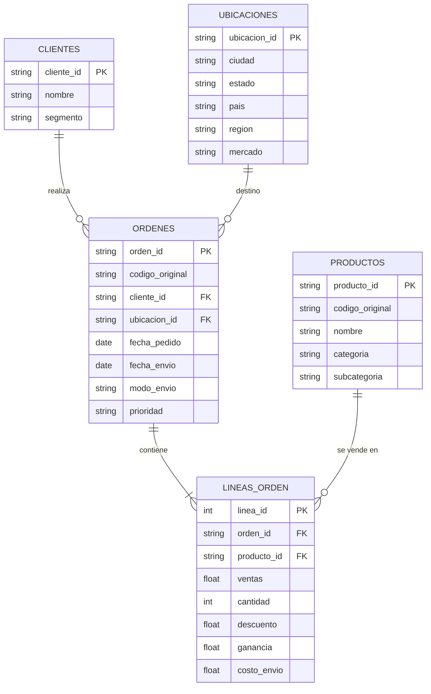

# Superstore en la nube: normalización, análisis y consultas con IA

Proyecto final del curso **Análisis de datos en la nube**.

## Pregunta

¿Qué combinaciones de mercado, subcategoría y nivel de descuento generan pérdidas, y puede una IA gratuita responder estas preguntas en lenguaje natural a partir de un modelo de datos normalizado?

## Datos

* **Fuente:** Global Superstore, conjunto de datos de ejemplo publicado por Tableau y difundido en [Kaggle](https://www.kaggle.com/datasets/apoorvaappz/global-super-store-dataset).
* **Naturaleza:** datos sintéticos de una tienda ficticia, usados con fines académicos para demostrar el proceso.
* **Tamaño:** 51 290 filas y 24 columnas, con ventas de 147 países entre 2011 y 2014.
* **Huella SHA256 del archivo:** `f4653031058bce3c6c510e0d113144133b36f83fa9bf03c03d66cf6c0567b89c`
* Los datos **no** se incluyen en el repositorio.

## Problemas encontrados en la base original

Al intentar normalizar descubrimos que las claves originales no son confiables:

1. **Órdenes repetidas:** 659 códigos de orden se usan para órdenes distintas, con otro cliente y otra fecha.
2. **Productos con dos nombres:** 457 códigos de producto corresponden a más de un producto. Por ejemplo, el mismo código identifica una perforadora y unas etiquetas.
3. **Ciudades en dos mercados:** ciudades de Austria como Viena, Graz y Linz aparecen a veces en el mercado EU y a veces en EMEA.
4. **Una orden con dos fechas:** aun combinando orden y cliente, la orden ES-2014-1903302 aparece con dos fechas diferentes.

**Solución:** se crearon claves nuevas que combinan varias columnas, de modo que cada registro queda identificado de forma única.

## Modelo normalizado

La tabla plana se separó en 5 tablas:

| Tabla | Filas |
|---|---|
| clientes | 1 590 |
| productos | 10 768 |
| ubicaciones | 3 819 |
| ordenes | 25 754 |
| lineas_orden | 51 290 |

**Verificación:** las ventas totales (12 642 501,91) son idénticas antes y después de normalizar, así que no se perdió información.

## Cómo reproducirlo

1. Descargar `Global_Superstore2.csv` y ponerlo en la carpeta `datos/`.
2. Instalar dependencias: `pip install -r requirements.txt`
3. Ejecutar: `python src/normalizar.py`
4. Las 5 tablas quedan en la carpeta `salidas/`.

## Herramientas

Python y pandas, Git y GitHub, GitHub Codespaces, Databricks Free Edition, GLM (Z.ai) por API y Docker.

## Equipo

| Integrante | Rol |
|---|---|
| Integrante 1 | Coordinación, datos y normalización |
| Integrante 2 | Nube y consultas en Databricks |
| Integrante 3 | IA y reproducibilidad |
